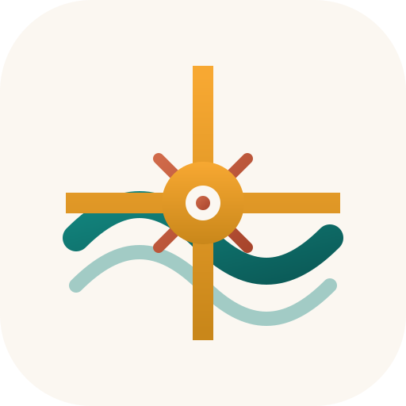

<p align="center">
  
</p>

<h1 align="center">Abbai Flow</h1>

<h3 align="center">Your family's daily signal</h3>

<p align="center">
  <a href="LICENSE"></a>
  <a href="https://github.com/nyabb/abbai-flow/releases"></a>
  <a href="https://github.com/nyabb/abbai-flow/stargazers"></a>
</p>

<p align="center">
  Abbai Flow is a free, open-source family organisation and gamification
  platform — routines, missions, chores, rewards and everyday family life on a
  wall-mounted display. Run it as a container next to Home Assistant, or
  standalone, with no subscription fees and no cloud dependency.
</p>

---

## Features

- **Weekly Calendar** -- Beautiful week view with color-coded family members; supports HA calendar entities and a built-in local calendar
- **Grocery & Shopping Lists** -- AnyList, Home Assistant Shopping List, and local list support
- **Task / Todo Lists** -- Home Assistant todo entities and local task lists with dashboard integration
- **Chore Tracking** -- Assign chores, track streaks, and celebrate completions with a family leaderboard
- **Music Controls** -- Control Music Assistant, Home Assistant media players, and browse playlists from the display
- **Photo Slideshow** -- Display family photos between interactions
- **Timer / Countdown** -- On-screen timer for cooking, homework, and more
- **Screen Saver** -- Automatic screen saver with clock overlay
- **Weather** -- Real-time weather from your Home Assistant weather entity
- **8+ Themes** -- Light, Midnight, Midnight Light, Nord, Dracula, Monokai, Rose, Forest, and dark mode (automatic or manual)
- **Family Management** -- Per-member colors, calendar filtering, and PIN-based profiles
- **Meal Planning** -- Meal plan bar with weekly dinner overview
- **Standalone Mode** -- Works without Home Assistant using local calendars, lists, and tasks

## Installation

Abbai Flow is a single container. It serves the web app and talks to Home
Assistant on the browser's behalf, so the tablet never needs a token.

### Docker (recommended)

```bash
docker run -d \
  --name abbai-flow \
  --restart unless-stopped \
  -p 3000:3000 \
  -e HA_URL=https://homeassistant.local:8123 \
  -e HA_TOKEN=your_long_lived_access_token \
  -v abbai-flow-data:/data \
  ghcr.io/nyabb/abbai-flow:latest
```

Open `http://<host>:3000`. Images are published for `linux/amd64` and
`linux/arm64`, so the same tag runs on a server and on a Raspberry Pi.

`HA_TOKEN` is a Home Assistant long-lived access token (Profile → Security →
Long-Lived Access Tokens). Without it, Abbai Flow still runs in standalone mode
with local calendars, lists and tasks.

### Docker Compose

```yaml
services:
  abbai-flow:
    image: ghcr.io/nyabb/abbai-flow:latest
    restart: unless-stopped
    ports: ['3000:3000']
    environment:
      HA_URL: https://homeassistant.local:8123
      HA_TOKEN: ${HA_TOKEN}
    volumes: ['abbai-flow-data:/data']

volumes:
  abbai-flow-data:
```

### Local development

```bash
npm ci
npm run dev          # http://localhost:5173
```

Set `VITE_HA_URL` and `VITE_HA_TOKEN` in `.env` to develop against a real Home
Assistant. Abbai Flow works fully without it — calendars, lists and tasks are
then kept in the browser.

## Configuration

| Variable | Default | Description |
| --- | --- | --- |
| `PORT` | `3000` | Port the container listens on |
| `HA_URL` | — | Home Assistant base URL |
| `HA_TOKEN` | — | Long-lived access token |
| `DATA_DIR` | `/data` | Where persisted documents are stored |

Everything else — themes, family members, chores, routines, rewards, calendar
sources, list providers — is configured through the Abbai Flow UI.

## Why Abbai Flow?

- **Free & open source** — no subscriptions, no cloud accounts, no vendor lock-in
- **Private by design** — all data stays on your network; nothing phones home
- **Home Assistant native** — deep integration with calendars, media players, lists, weather, and more
- **Works standalone** — built-in local calendar, task lists, and shopping lists work without HA
- **Fully themeable** — 8+ themes with automatic dark mode
- **Voice & LLM ready** — MCP server, voice API, and HA custom sentences for hands-free control

## Built With

- [React 19](https://react.dev/) -- UI framework
- [TypeScript](https://www.typescriptlang.org/) -- Type safety
- [Vite](https://vitejs.dev/) -- Build tool
- [Home Assistant](https://www.home-assistant.io/) -- Smart home platform
- [React 19](https://react.dev/) -- UI framework
- [Lucide](https://lucide.dev/) -- Icons
- [date-fns](https://date-fns.org/) -- Date utilities

## Documentation

- [Getting Started Guide](docs/getting-started.md) -- full walkthrough with screenshots
- [AI and Voice Control](docs/ai-integration.md) -- voice API, MCP server for LLM agents, HA Assist custom sentences
- [Contributing Guide](CONTRIBUTING.md)
- [Changelog](CHANGELOG.md)
- [Security Policy](SECURITY.md)
- [Code of Conduct](CODE_OF_CONDUCT.md)
- [License](LICENSE)

## Contributing

Contributions are welcome! Please read the [Contributing Guide](CONTRIBUTING.md) before submitting a pull request.

## Support Abbai Flow

Abbai Flow is free and always will be. If it's useful to your family, consider supporting development:

<p>
  <a href="https://github.com/sponsors/asachs01"></a>
  <a href="https://buymeacoffee.com/aaronsachs"></a>
</p>

## License

Abbai Flow is [MIT licensed](LICENSE). Copyright 2026 Aaron Sachs.
