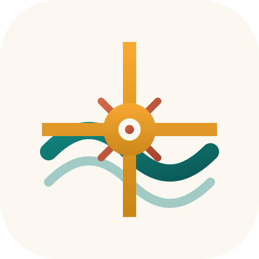

<p align="center">
  
</p>

<h1 align="center">Abbai Flow</h1>

<h3 align="center">Your family's daily signal</h3>

<p align="center">
  <a href="LICENSE"></a>
  <a href="https://github.com/nyabb/abbai-flow/releases"></a>
  <a href="https://github.com/nyabb/abbai-flow/stargazers"></a>
</p>

Abbai Flow is a free, self-hosted family organizer for calendars, routines,
chores, rewards, meals, and shared displays. The app and its data run on your
own server, with no required cloud account.

## Features

- Weekly calendar with local events and connected CalDAV, ICS, or Google calendars
- Chores, routines, rewards, points, and family profiles
- iCloud Reminders and built-in task lists
- Meal planning, weather, Spotify and Encore music playback
- Optional Bluetooth device management on Linux hosts
- Uploaded screen saver photos, clock, or both
- Responsive phone and tablet layouts with Kid Display profiles

## Install with Docker

```bash
docker run -d \
  --name abbai-flow \
  --restart unless-stopped \
  -p 3000:3000 \
  -v abbai-flow-data:/data \
  ghcr.io/nyabb/abbai-flow:latest
```

Open `http://<host>:3000`. The persistent `/data` volume stores family data,
integration settings, and uploaded screen saver photos.

For Docker Compose:

```yaml
services:
  abbai-flow:
    image: ghcr.io/nyabb/abbai-flow:latest
    restart: unless-stopped
    ports: ['3000:3000']
    volumes: ['abbai-flow-data:/data']

volumes:
  abbai-flow-data:
```

## Local development

```bash
npm ci
npm run dev
```

The Vite development server runs at [http://localhost:3000](http://localhost:3000).
Run `npm start` with a production build to use the app server locally.

## Configuration

| Variable | Default | Description |
| --- | --- | --- |
| `ABBAI_FLOW_PORT` or `PORT` | `3000` | HTTP port |
| `ABBAI_FLOW_DATA` | `/data` | Persistent data directory |
| `ABBAI_FLOW_DIST` | `/app/dist` | Built app directory |
| `ABBAI_FLOW_ALLOWED_ORIGINS` | — | Extra origins allowed to make state-changing requests |
| `ABBAI_FLOW_BLUETOOTH_DBUS_ADDRESS` | — | Optional host D-Bus address for Bluetooth management |

Configure calendars, lists, weather, meals, and music from **Settings →
Integrations**. Integration secrets are stored in the data directory and are
not included in browser runtime configuration. For Bluetooth controls, mount
the host D-Bus socket into the container and set the address to
`unix:path=/run/dbus/system_bus_socket`.

## Documentation

- [Getting Started Guide](docs/getting-started.md)
- [Contributing Guide](CONTRIBUTING.md)
- [Changelog](CHANGELOG.md)
- [Security Policy](SECURITY.md)
- [Code of Conduct](CODE_OF_CONDUCT.md)
- [License](LICENSE)

## License

Abbai Flow is [MIT licensed](LICENSE). Copyright 2026 Aaron Sachs.
