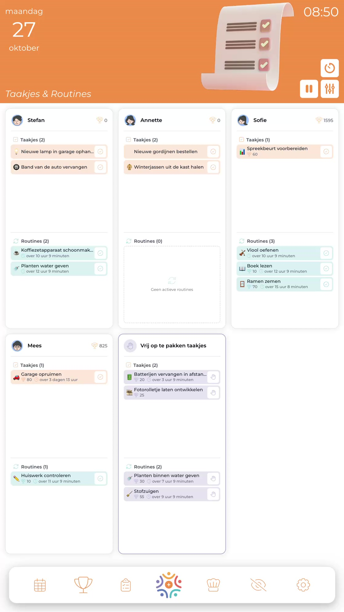
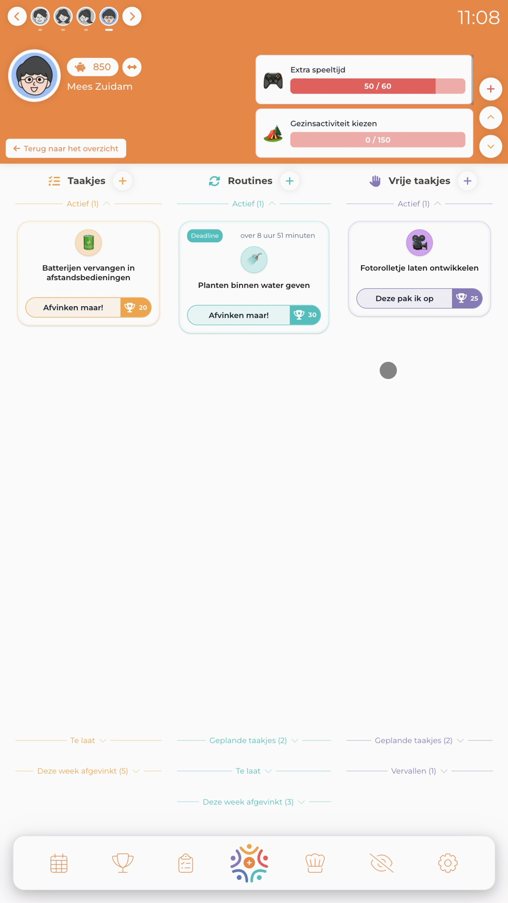
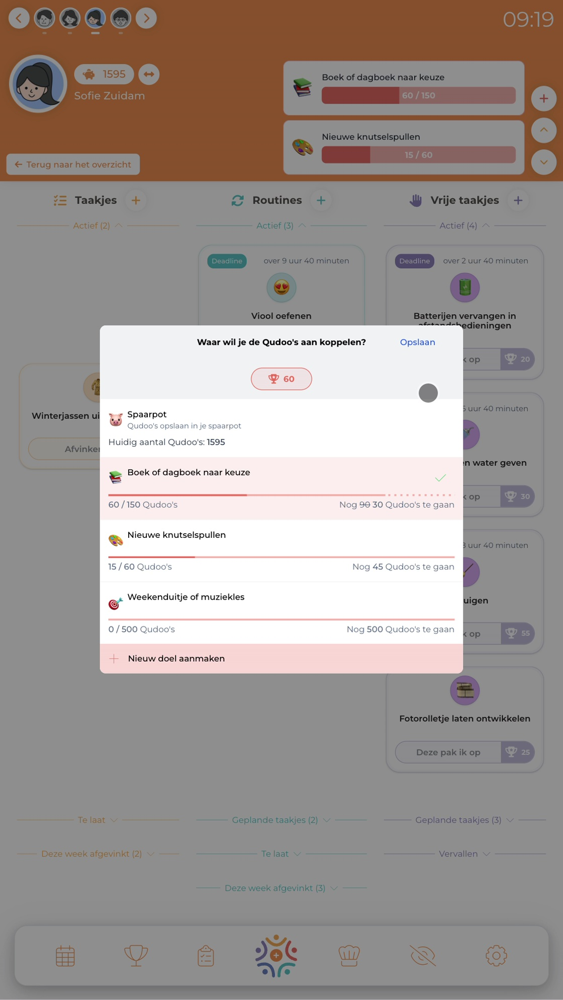
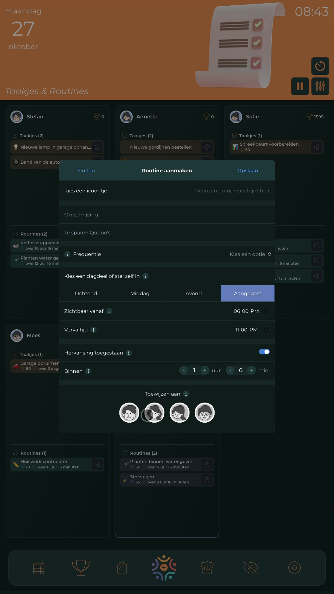
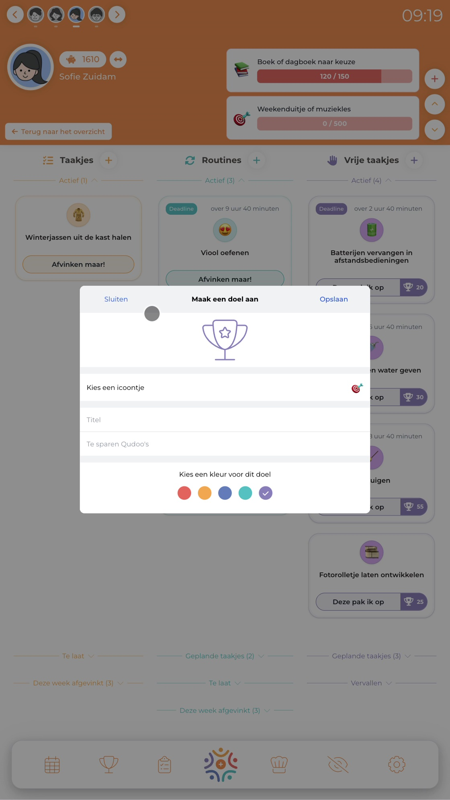

# Qudoo chores: interaction and component analysis

**Prepared:** 28 November 2026

**Scope:** Qudoo Chores screens and workflows, compared with the current Abbai Flow Chores implementation. This is a research document; it does not change the app UI.

## What the review found

Qudoo’s Chores experience is organized around a family overview, a focused child detail view, and a guided “mission” flow. Its visible distinction is the way it stages information: task cards show the action and reward together; routines are grouped by time of day and progress; goals appear beside the child’s balance; and completing a paid chore leads directly into a goal-allocation choice.

Abbai Flow already implements most of the underlying chores concepts: assigned and claimable chores, routine steps, pause and resume, completion review, reward goals, point allocation, and a guided mission mode. The larger gap is the interaction hierarchy and density. Abbai Flow presents compact rows and goal cards inside the all-family columns, while Qudoo uses larger, more task-oriented cards and a stronger child-focused detail screen.

The reward amount editor is already a sheet/modal in Abbai Flow (`AssignPointsSheet`). On the all-family board, however, every goal row and its progress/actions are rendered inline under each child. The likely improvement is to make that board area a compact balance/goal summary and open the full goal list and allocation actions in a popup. The current source confirms the inline goal area; the exact screen where it feels too large should be visually checked when implementation begins.

## Evidence reviewed

- Seven local Qudoo Chores video clips: `detailspagina.mov`, `detailspaginaen doelen .mov`, `routineannmaken.mov`, `routine pauzere.mov`, `vrijtaken oppaken .mov`, `spar doelen.mov`, and `17d80c3c7ecb4db79415a88f044f85ce.mov`. The analysis uses sampled stills to identify the visible screens and controls; it does not infer spoken narration or unseen tap targets.
- Qudoo’s official [Chores and routines page](https://qudoo.nl/pages/routines-en-to-dos), [FAQ](https://qudoo.nl/pages/veelgestelde-vragen), [user guide](https://qudoo.nl/pages/handleiding), [feature overview](https://qudoo.nl/pages/alle-qudoo-functionaliteiten), and [article about chores at home](https://qudoo.nl/pages/hoe-qudoo-ervoor-zorgt-dat-kinderen-moeiteloos-meewerken-in-huis).
- Abbai Flow implementation: `src/components/chore-planner/ChoreBoard.tsx`, `ChildView.tsx`, `rows.tsx`, `MissionView.tsx`, `ChorePlanner.tsx`, `ChoreEditor.tsx`, `sheets.tsx`, `sheets/RewardSheets.tsx`, and `src/components/routines/RoutineEditorDialog.tsx`.

Qudoo’s website describes product intent as well as controls. In particular, it says routines help children build habits, chores should be clear about what and when, children can pick up open tasks themselves, and completed chores can contribute to personal goals. These are Qudoo’s own product claims, not independent usability findings. The FAQ provides the more concrete interaction rules referenced below.

## The screens and the job each one does

### 1. Family overview: scan and choose

**What is visible:** the main screen places family members side by side, with an open/free-task area alongside them. A child’s chores and routine tasks are grouped in that child’s column. A “take this” action appears on free tasks. Points sit close to the task and goal context.

**How it is used:** the parent scans who has tasks to do, sees which routines are active, and opens a member’s detail view when they need more information. A child can also act on a free task from this overview. Qudoo’s FAQ says the overview can filter family members and that a member card opens the detailed view.

**Abbai Flow counterpart:** `ChoreBoard.tsx` renders a member column per visible family member and a separate free-chore column. Each member header opens that child, shows their spendable points, and can start missions. On phones, the board selects one member and exposes Chores, Routines, Goals, and Free tabs.

**Observed difference:** Qudoo’s task cards make the task action and point value feel like a single, large target. Abbai Flow’s `TaskRow` is intentionally denser: a separate round action button, task name/status hint, points badge, and overflow menu. The compact rows make more fit on screen but reduce the visual prominence of “do this next.”

### 2. Child detail: see one child’s progress

**What is visible:** the detail page centers one child, with previous/next child navigation, their balance and goal cards, and separate groups for chores, routines, free tasks, and completed work. In the sampled view, late, planned, and completed items are separated into collapsible groups.

**How it is used:** select a child from the family overview, review what is open or overdue, and inspect progress toward each goal. Qudoo’s FAQ says the main display shows active, late, upcoming, and completed work; its companion app also separates Goals, Tasks, Routines, and Free tasks into tabs.

**Abbai Flow counterpart:** `ChildView.tsx` has child navigation, spendable points, goals, chore/routine/free-task sections, and a completion history filter for the last two days, week, or all time. Mission launch is in the child header and routines section.

**Observed difference:** Abbai’s detail is structurally similar, but the reference gives the profile/goals area more visual weight and organizes task status more explicitly within the page. Abbai’s current detail history is a dated list rather than Qudoo’s sampled open/late/completed task groupings. On small screens, Abbai puts Goals in a tab on the board; Qudoo’s phone companion navigation separates goals, tasks, routines, and free tasks as peer destinations.

### 3. Finish a chore: feedback, then choose where points go

**Observed sequence:** a child taps the completion action (“Afvinken maar!”). For a chore with points, Qudoo opens “Waar wil je de Qudoo’s aan koppelen?” The child can choose the savings pot or an existing goal, or start a new goal. The selected destination is visibly indicated before continuing. Qudoo’s FAQ says the completion produces confetti and sound, then offers this allocation step; a no-points chore can finish directly.

**Abbai Flow counterpart:** task completion runs through a confirmation action and then an `AwardSheet` that offers goal destinations; `AssignPointsSheet` asks for the amount. The planner prevents duplicate submission while the action saves and provides confetti/toast feedback. Tasks that require parent review wait for parent approval, with the parent action gated through the PIN when configured.

**Observed difference:** Qudoo makes the “task complete → points destination” connection a strong part of the chore flow. Abbai has the same key choice, but it is split into the award sheet and amount sheet. In the all-family view, the goal rows remain visible within each child column, even though the numeric allocation editor itself is not inline.

### 4. Create and manage a routine

**What is visible:** the routine editor collects an icon/name, points, recurrence, daypart or custom schedule, visible-from/deadline timing, retry behavior, and family members. A separate sampled screen shows editing an existing routine. The FAQ describes daily, weekly, and monthly recurrence, time-of-day windows, pausing routines, and editing or deleting a routine.

**How it is used:** parents define a repeatable bundle, when it should appear, who owns it, and what happens after a missed attempt. Children work through its steps; the interface shows routine progress and can launch a guided run.

**Abbai Flow counterpart:** `RoutineEditorDialog.tsx` creates/edits a family routine with a name/icon, morning/afternoon/evening time, weekdays, member assignment, and ordered steps. `FamilyRoutineRow` shows its steps and completion progress and supports pause/resume and edit/delete. `MissionView.tsx` runs a routine step by step. Standalone chores have a separate editor (`ChoreEditor.tsx`) with recurrence, deadlines, and retry fields.

**Observed difference:** Qudoo presents routine setup as one coherent schedule-oriented editor. Abbai’s chores and family routines are two different models: family routines use a time-of-day and weekdays; ChoresMan chores have their own due dates, retries, and recurrence editor. This gives Abbai flexibility, but the split can make the chore/routine distinction harder to learn. Do not treat the two editors as interchangeable when matching Qudoo behavior.

### 5. Create a goal

**What is visible:** the goal is represented by a title, icon, target points amount, and color. The FAQ also describes assigning a goal to one or more family members and supporting shared goals.

**How it is used:** a parent creates a goal from the overview or child detail. Later, points earned from chores can be assigned toward it. The child can see progress; when the goal is reached, the reward can be fulfilled or reset for another round.

**Abbai Flow counterpart:** reward goals are created and edited through the reward form sheet. Each `RewardRow` displays allocated/target points, remaining amount, status, and eligible actions. Reward requests and fulfilment approval are tracked separately from the goal definition.

**Observed difference:** Abbai’s goal rows communicate detailed progress and administrative state inline. Qudoo’s goal is presented more as a visual destination. A summary card in the all-family view with details moved to a popup would align with the latter hierarchy and address the current size concern.

## Component inventory and interaction mapping

| Qudoo component | How the user uses it | Abbai Flow implementation | Comparison |
|---|---|---|---|
| Family chores overview | Scan each person, their open work/routines, and tasks anyone may take; filter members or open a person. | `ChoreBoard.tsx` | Same core navigation model. Abbai’s columns are denser and show each child’s goal rows inline. |
| Member profile/header | Identify child, view balance and goals, move to another child, enter the child’s detail. | `ChildView.tsx`; member header in `ChoreBoard.tsx` | Same actions exist. Qudoo gives the profile and goal progress stronger visual priority. |
| Chore card and completion button | Read the task, timing, and points, then complete it; late/upcoming states are clear. | `TaskRow` in `rows.tsx`; completion and status logic in `ChorePlanner.tsx` | Same basic lifecycle, different target size and information density. Abbai separates task text, check button, points, and actions. |
| Free task | Choose “Deze pak ik op”; in the overview, choose which child claims it; thereafter it belongs to that child. | Free-task column/tab, `ClaimSheet`, `claimOptionsFor` in `ChorePlanner.tsx` | Function exists. Abbai uses a chooser when multiple child-specific claim options exist. |
| Routine group and step list | Open the routine, see time/day and steps, tick steps, see progress, pause or resume. | `FamilyRoutineRow` / `RoutineRow` in `rows.tsx`; `RoutineEditorDialog.tsx` | Function exists, including step progress and pause/resume. The visual treatment is more compact and less card-like. |
| Guided chore run | Start a routine, work through one step at a time, see progress and a completion state. | `MissionView.tsx` and mission state in `ChorePlanner.tsx` | Abbai has a guided routine run and celebration. Its flow should be compared screen by screen with the Qudoo videos before assuming parity in timing or copy. |
| Goal card and point assignment | View target/progress; after finishing a paid task choose a goal or savings; allocate saved points later if desired. | `RewardRow`, `AwardSheet`, `AssignPointsSheet`, `GoalsSheet` | Allocation form is already a popup. Goal summaries/actions occupy space on the all-member board. |
| Completion review | Undo a completion, review completed/late work, approve a child’s task if review is enabled. | `ActionsSheet`, `ApprovalDialog`, `ChildView` history, PIN-gated handlers in `ChorePlanner.tsx` | Abbai supports these controls, but they are exposed through its action/history patterns rather than Qudoo’s exact status groups. |

## Workflows described by Qudoo’s site

### Add and assign a chore

Qudoo’s FAQ says the flow starts from the plus control in Tasks & Routines, then “Taakje toevoegen.” The user enters a name or icon, positive point value, and at least one assignee, with optional deadline and retry. Selecting several family members creates a separate chore instance for each. A free chore has no assignee and is available for someone to take. A deadline can make an assigned chore late; a free chore expires instead.

Abbai Flow’s chore editor supports assignees/everyone/free, points, description/labels, deadlines, retry, and recurrence on edit. The chore model is distinct from family routines. The implementation should preserve the differences between assigned late work and claimable free work when adapting visuals.

### Claim a free chore

Qudoo’s FAQ says children can claim a free chore with “Deze pak ik op”; on the main screen, selecting one opens a member chooser. A free chore has an expiry, and an expired item can be recreated or deleted. Abbai implements a free-task area and a claim sheet and navigates to the claiming child’s list after a successful claim. This behavior is present, though the video stills make Qudoo’s self-claim button more immediate and visible.

### Complete, award, undo

After completion, Qudoo confirms the action with confetti/sound and offers a goal/savings destination when the task carries points. Its FAQ says undoing a completion can restore the chore, mark it late, duplicate it, or delete it, and reverses awarded points. Abbai has a confirmation flow, award sheet, celebration, parent review, and action menu. This looks more like a difference in sequence and presentation than a missing points workflow.

### Routine, pause, and resume

Qudoo’s guide and FAQ describe repeating routines with days/time windows, progress through their chores, and a global pause/resume control. Abbai’s routine row supports pause/resume and shows step completion counts. The current `Routine` model uses daypart and weekday values; the ChoresMan chore editor separately supports custom recurrence and retry. The current screen should make that split understandable, especially when the user expects a routine editor to contain every schedule rule in one place.

### Goals and fulfilment

Qudoo describes a goal as a visible target. Points can be allocated after a chore or moved from savings later, subject to available points and what the target still needs. Abbai supports allocation after completion and later allocation from existing savings, plus undoing an allocation and parent approval/fulfilment. On the all-family board, the detail of each goal currently competes with the chores for space.

## Design and flow takeaways for the next implementation pass

These are analysis recommendations only; no code/UI changes are included in this review.

1. **Give the all-family page a clear scan order.** Keep member identity and balance at the top; show only a concise goal summary or “Goals” entry there. Open full goal progress and point allocation in a popup/sheet.
2. **Make the task itself the primary target.** Match Qudoo’s task-first hierarchy: recognizable icon, short title, visible due/late state, and one obvious completion/claim action. Keep secondary edit/delete controls behind the overflow menu.
3. **Make status groups legible.** Qudoo separates active, upcoming, late, expired, and completed work. Abbai already computes task states, but its board emphasizes compact rows and deadline sorting. A later visual pass should decide which states deserve their own sections per screen.
4. **Keep routines recognizable as routines.** Show time/day, steps remaining, and a clear pause/play state. Preserve the guided mission path as a child flow, while keeping parent edit/delete actions secondary.
5. **Use the child detail for progress.** Keep goals, available balance, routines, and completed work in a more spacious view than the all-family board.
6. **Confirm which reward element is oversized.** In source, `AssignPointsSheet` is already modal. If the complaint refers to that dialog, inspect its live dimensions; if it refers to the goal cards visible in every board column, the recommended change is to collapse those cards and open the full allocation controls on demand.

## Evidence limits

The screenshots are sampled stills from the supplied Qudoo videos, so they document visible component structure and state, not every animation, hit area, or exact transition timing. Official Qudoo pages provide workflow descriptions but are vendor-authored. The Abbai comparison is based on the named source files on this branch; it is not a fresh end-to-end usability test. These limits matter most for exact choreography, responsive behavior, and whether a specific control has an alternate gesture.

## Source links

- Qudoo: [Tasks and routines](https://qudoo.nl/pages/routines-en-to-dos)
- Qudoo: [FAQ](https://qudoo.nl/pages/veelgestelde-vragen)
- Qudoo: [User guide](https://qudoo.nl/pages/handleiding)
- Qudoo: [All features](https://qudoo.nl/pages/alle-qudoo-functionaliteiten)
- Qudoo: [How Qudoo aims to make household chores easier](https://qudoo.nl/pages/hoe-qudoo-ervoor-zorgt-dat-kinderen-moeiteloos-meewerken-in-huis)
- Abbai Flow: [`ChoreBoard.tsx`](../../src/components/chore-planner/ChoreBoard.tsx), [`ChildView.tsx`](../../src/components/chore-planner/ChildView.tsx), [`rows.tsx`](../../src/components/chore-planner/rows.tsx), [`MissionView.tsx`](../../src/components/chore-planner/MissionView.tsx), [`ChorePlanner.tsx`](../../src/components/chore-planner/ChorePlanner.tsx), [`RewardSheets.tsx`](../../src/components/chore-planner/sheets/RewardSheets.tsx), [`RoutineEditorDialog.tsx`](../../src/components/routines/RoutineEditorDialog.tsx).
